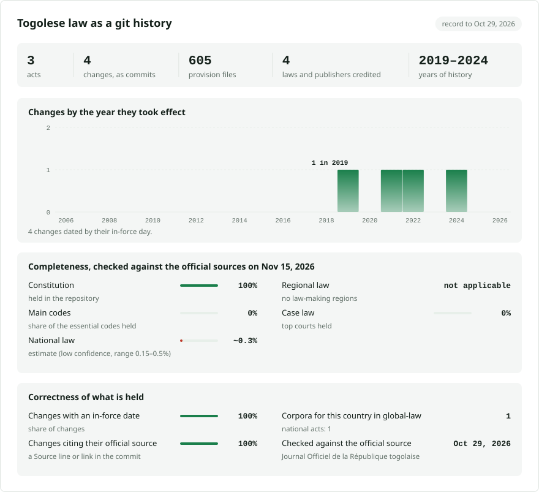

# Togo: law history in git

[Français](README.md) · **English**

<picture>
<source media="(prefers-color-scheme: dark)" srcset="data/effort-dark.svg">

</picture>

The law of Togo as a git history: one file per provision, each version committed on the day it took effect, and the law that made each change as the commit's author. `git blame` names the law behind every paragraph; `git log` lists every change to an article; picking a date gives the text in force that day.

Part of [lexifina/global-law](https://github.com/lexifina/global-law), one git history for every country's law: this is Togo's national law, which global-law reads at `togo/national/acts/`.

**What is in it now:** 9,109 acts from the Journal officiel de la République togolaise (1923–2026), each as published: the Constitution of 6 May 2024 and earlier constitutions, the codes (`codes/`), and the lois, ordonnances, décrets, arrêtés and décisions by type and year. Layout and dating rules: [STRUCTURE.md](STRUCTURE.md). No case law, bills or individual measures (appointments, honours).

Each provision is one file in its act's folder (`codes/code-du-travail/art-190.md` is Article 190 of the Code du travail); the Constitution's preamble is `constitution/preambule.md`, and the Déclaration's articles are files such as `constitution/declaration-art-005.md`.

The text is in French, the official language of Togo, as the Journal officiel prints it. An English translation is not part of this record.

## Questions as git commands

| Question | Command |
| --- | --- |
| Every change to Article 190 of the Code du travail (maternity leave) | `git log -p --word-diff -- codes/code-du-travail/art-190.md` |
| Which law wrote each line of Article 190? | `git blame codes/code-du-travail/art-190.md` |
| Every version of Article 190, with the day each took effect | `git log --format="%h %(trailers:key=In-force,valueonly,separator=) %an" -- codes/code-du-travail/art-190.md` |
| Article 190 as in force on 1 January 2022 | `python tools/en_vigueur_au.py 2022-01-01 codes/code-du-travail 190` |

**Outside git**, we also host this record publicly, for free:

- **[Ask Claude about Togolese law](https://global-law.lexifina.com/v1/try_claude?country=togo)**: opens Claude with a first question ready.
- **[Ask ChatGPT](https://global-law.lexifina.com/v1/try_chatgpt?country=togo)**: the same question in ChatGPT.
- **[Search Togolese law on our site](https://lexifina.com/law?country=togo&q=cong%C3%A9+pay%C3%A9)**: a search for "congé payé" (paid leave), with each provision's text and its versions, no account needed.
- **[Developer REST API](https://global-law.lexifina.com/v1/search_law?query=cong%C3%A9+pay%C3%A9&jurisdiction=togo)**: the same search as JSON, with no key. See the [documentation here](https://lexifina.com/api/global-law).

Both assistants read the record through the free Global law connector (MCP, `https://global-law.lexifina.com/mcp`); the first time, the chat gives you the link that adds it. Ask in French or in English.

**Host it yourself easily.** All it takes is git and Python, and the tools run on your machine:

```sh
git clone --depth 1 https://github.com/lexifina/global-law && cd global-law
python3 tools/countries.py add togo/national/acts
python3 tools/law.py show 2026-01-01 togo/national/acts/codes/code-du-travail/art-190.md
```

Opened in Claude Code, Cursor, VS Code or Codex, the clone also starts a local MCP server with the same tools ([MCP.md](https://github.com/lexifina/global-law/blob/main/MCP.md)).

## Dates

Each commit is dated at noon, Africa/Lome (UTC), on the day the version took effect, and carries it in its `In-force:` trailer; `Enacted:` and `Published:` give the day of promulgation and of the Journal officiel:

- since the 2024 Constitution, laws take effect on promulgation ("Les lois entrent en vigueur dès leur promulgation", art. 33); the Constitution itself was promulgated and published on 6 May 2024;
- before it, no general rule was found, and each law ends "sera exécutée comme loi de l'Etat" with no day of its own, so it is dated by its "Fait à Lomé" line: 18 June 2021 for the Code du travail, 15 November 2022 for Loi n° 2022-019;
- Loi n° 2019-014 is titled "du 29 octobre 2019" and printed in the Journal officiel of that day, but signed on 30 October 2019, the day it is dated.

Each act's first commit is the act as promulgated, credited to the act itself; the 2022 commit holds only Article 190, credited to Loi n° 2022-019. The committer is always Lexifina.

## How it is checked

- `tools/check_repo.py` reads every version back from git on the day it took effect and on the day before, and both must match the corpus the history was built from; it also checks that every commit's trailers parse, that there are no merge commits and that no commit is dated in the future. The results are in [`REPRODUCE.md`](REPRODUCE.md).
- `tools/build.py` writes the history from that corpus in one pass, and the same corpus always gives the same commit hashes; [`data/corpus.sha256`](data/corpus.sha256) gives the corpus's hash.
- Nothing dropped: every word of each law is in a provision file, except its title, enacting formula, headings, article numbers and signatures.
- Loi n° 2019-014 agrees with the Assemblée nationale's text as adopted on 23 October 2019 apart from spacing and one accent. The Constitution agrees with the Assemblée nationale's copy except one phrase in Article 60, where the Journal officiel's wording is kept.
- [vulnerabilities/](vulnerabilities/README.en.md): possible drafting mistakes in this law, found by global-law's detectors and checked by hand. Not run yet.

## What it does not show

- **Consolidated texts.** Each act is filed as published; amending acts are their own folders and are not yet applied to the codes they amend (the Code du travail's Article 190 is the one exception).
- **Acts held back**: acts whose entry into force is deferred or whose dates contradict each other, and acts whose heading the issue text does not show; see STRUCTURE.md.
- **Exact wording for old issues.** The text is the Journal officiel platform's own text of each issue; for scanned issues it is the publisher's OCR, kept uncorrected (`Text-source: publisher OCR` in each commit).
- **Headings** (titres, chapitres, sections), the enacting formula and the signatures; each file starts "# Article N".
- **Anything published after the newest issue fetched**; the runner rereads the Journal officiel platform.

## Sources

| Source | Kind | Past versions | Notes |
| --- | --- | --- | --- |
| [Journal officiel de la République togolaise](https://new.jo.gouv.tg) | Official gazette platform: every issue from 1922 with its text and its list of acts (public JSON API, odoo.jo.gouv.tg) | no consolidation; each act as published | Every act and its dates |
| Assemblée nationale du Togo ([Loi n° 2019-014 as adopted, Internet Archive capture](https://web.archive.org/web/20230605220852/https://assemblee-nationale.tg/wp-content/uploads/2021/10/donnees-perso-LOI-AN.pdf)) | Texts as adopted in plenary; a copy of the 2024 Constitution | as adopted | Used only to check the text |

## Licence

See [`LICENSE`](LICENSE). The texts are official legal texts of the Togolese Republic from the Journal officiel, reproduced with that attribution; jo.gouv.tg publishes no licence for them, and their copyright status is not confirmed. The history, commit messages, tables and tools are CC0 1.0.

No AI model wrote, translated or corrected legal text, and none runs when the history is built; the scripts were written by an AI model (see [`REPRODUCE.md`](REPRODUCE.md)).

## Visualisations

- [visualisations/](visualisations/README.en.md): charts drawn from this repository. Not drawn yet.

## More

From [lexifina/global-law](https://github.com/lexifina/global-law):

- [FEATURES.md](https://github.com/lexifina/global-law/blob/main/FEATURES.md): every feature, and what every corpus must support (`git blame`, `law.py`, the MCP tools)
- [FAQ.md](https://github.com/lexifina/global-law/blob/main/FAQ.md): questions and answers · [CONTRIBUTING.md](https://github.com/lexifina/global-law/blob/main/CONTRIBUTING.md): proposing changes · [MCP.md](https://github.com/lexifina/global-law/blob/main/MCP.md): the MCP server · [REPRODUCE.md](https://github.com/lexifina/global-law/blob/main/REPRODUCE.md): how it was built · [CHANGELOG.md](https://github.com/lexifina/global-law/blob/main/CHANGELOG.md)
- [FRESHNESS.md](https://github.com/lexifina/global-law/blob/main/FRESHNESS.md): how current each corpus is · [Monitoring](https://github.com/lexifina/global-law/tree/main/monitoring): whether updates are running · [WATCHING.md](https://github.com/lexifina/global-law/blob/main/WATCHING.md): how each official source is watched for changes
- [performance/](https://github.com/lexifina/global-law/tree/main/performance): how fast the tools are, measured
- [visualisations/](https://github.com/lexifina/global-law/tree/main/visualisations): charts and bridges across the world's law
- [Vulnerabilities](https://github.com/lexifina/global-law/tree/main/vulnerabilities): mistakes in legislation as published
