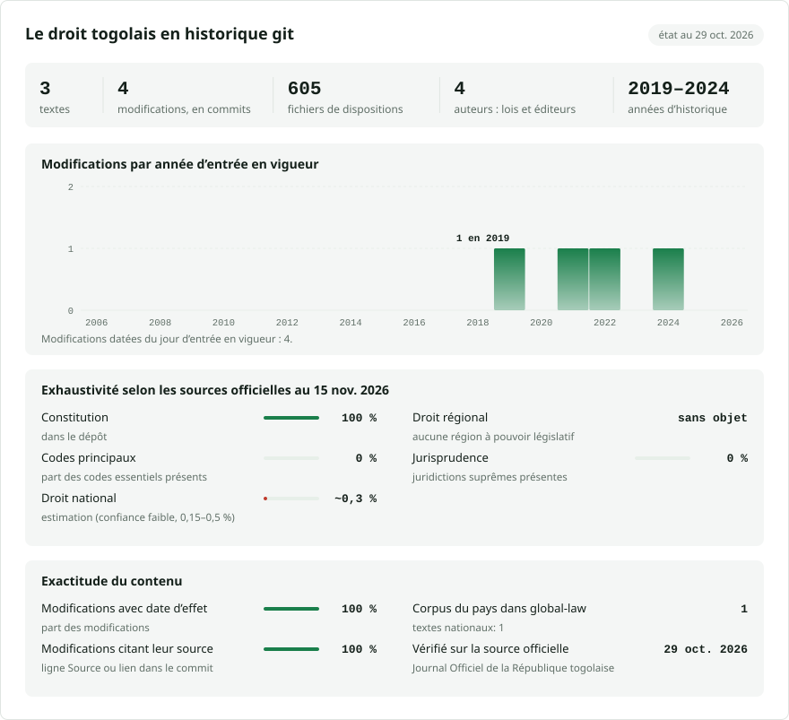

# Togo : l’histoire du droit dans git

**Français** · [English](README.en.md)

<picture>
<source media="(prefers-color-scheme: dark)" srcset="data/fr/effort-dark.svg">

</picture>

Le droit du Togo sous la forme d’un historique git : un fichier par disposition, chaque version enregistrée dans un commit à la date de son entrée en vigueur, et la loi auteur de chaque modification comme auteur du commit. `git blame` indique la loi à l’origine de chaque alinéa ; `git log` liste toutes les modifications d’un article ; le choix d’une date donne le texte en vigueur ce jour-là.

Fait partie de [lexifina/global-law](https://github.com/lexifina/global-law), un historique git unique pour le droit de tous les pays : il s’agit ici du droit national du Togo, que global-law lit sous `togo/national/acts/`.

**Contenu actuel :** 8,117 actes du Journal officiel de la République togolaise (1941–2026), chacun tel que publié : la Constitution du 6 mai 2024 et les constitutions antérieures, les codes (`codes/`), et les lois, ordonnances, décrets, arrêtés et décisions par type et par année. Organisation et règles de datation : [STRUCTURE.md](STRUCTURE.md). Ni jurisprudence, ni projets, ni mesures individuelles (nominations, distinctions).

Chaque disposition est un fichier dans le dossier de son texte (`codes/code-du-travail/art-190.md` est l’article 190 du Code du travail) ; le préambule de la Constitution est `constitution/preambule.md`, et les articles de la Déclaration sont des fichiers tels que `constitution/declaration-art-005.md`.

Le texte est en français, langue officielle du Togo, tel que l’imprime le Journal officiel. Une traduction anglaise ne fait pas partie de ce corpus.

## Questions sous forme de commandes git

| Question | Commande |
| --- | --- |
| Toutes les modifications de l’article 190 du Code du travail (congé de maternité) | `git log -p --word-diff -- codes/code-du-travail/art-190.md` |
| Quelle loi a rédigé chaque ligne de l’article 190 ? | `git blame codes/code-du-travail/art-190.md` |
| Toutes les versions de l’article 190, avec la date d’entrée en vigueur de chacune | `git log --format="%h %(trailers:key=In-force,valueonly,separator=) %an" -- codes/code-du-travail/art-190.md` |
| L’article 190 tel qu’en vigueur au 1er janvier 2022 | `python tools/en_vigueur_au.py 2022-01-01 codes/code-du-travail 190` |

**En dehors de git**, nous hébergeons aussi ce corpus publiquement, gratuitement :

- **[Interroger Claude sur le droit togolais](https://global-law.lexifina.com/v1/try_claude?country=togo)** : ouvre Claude avec une première question prête.
- **[Interroger ChatGPT](https://global-law.lexifina.com/v1/try_chatgpt?country=togo)** : la même question dans ChatGPT.
- **[Rechercher dans le droit togolais sur notre site](https://lexifina.com/law?country=togo&q=cong%C3%A9+pay%C3%A9)** : une recherche de « congé payé », avec le texte de chaque disposition et ses versions, sans compte.
- **[API REST pour développeurs](https://global-law.lexifina.com/v1/search_law?query=cong%C3%A9+pay%C3%A9&jurisdiction=togo)** : la même recherche au format JSON, sans clé. Voir la [documentation ici](https://lexifina.com/api/global-law).

Les deux assistants lisent le corpus au moyen du connecteur gratuit Global law (MCP, `https://global-law.lexifina.com/mcp`) ; la première fois, la conversation vous donne le lien qui l’ajoute. Posez vos questions en français ou en anglais.

**L’héberger vous-même, simplement.** Il suffit de git et de Python, et les outils s’exécutent sur votre machine :

```sh
git clone --depth 1 https://github.com/lexifina/global-law && cd global-law
python3 tools/countries.py add togo/national/acts
python3 tools/law.py show 2026-01-01 togo/national/acts/codes/code-du-travail/art-190.md
```

Ouvert dans Claude Code, Cursor, VS Code ou Codex, le clone démarre aussi un serveur MCP local doté des mêmes outils ([MCP.md](https://github.com/lexifina/global-law/blob/main/MCP.md)).

## Dates

Chaque commit est daté à midi, heure Africa/Lome (UTC), du jour où la version est entrée en vigueur, et porte cette date dans son trailer `In-force:` ; `Enacted:` et `Published:` donnent la date de promulgation et celle du Journal officiel :

- depuis la Constitution de 2024, les lois entrent en vigueur dès leur promulgation (« Les lois entrent en vigueur dès leur promulgation », art. 33) ; la Constitution elle-même a été promulguée et publiée le 6 mai 2024 ;
- auparavant, aucune règle générale n’a été trouvée, et chaque loi se termine par « sera exécutée comme loi de l'Etat » sans date propre ; elle est donc datée de sa mention « Fait à Lomé » : le 18 juin 2021 pour le Code du travail, le 15 novembre 2022 pour la Loi n° 2022-019 ;
- la Loi n° 2019-014 est intitulée « du 29 octobre 2019 » et publiée au Journal officiel du même jour, mais signée le 30 octobre 2019, date retenue pour la dater.

Le premier commit de chaque texte est le texte tel que promulgué, attribué au texte lui-même ; le commit de 2022 ne contient que l’article 190, attribué à la Loi n° 2022-019. Le committer est toujours Lexifina.

## Méthode de vérification

- `tools/check_repo.py` relit chaque version dans git le jour de son entrée en vigueur et la veille, et les deux doivent correspondre au corpus à partir duquel l’historique a été construit ; il vérifie aussi que les trailers de chaque commit sont analysables, l’absence de commits de fusion et qu’aucun commit n’est daté dans le futur. Les résultats figurent dans [`REPRODUCE.md`](REPRODUCE.md).
- `tools/build.py` écrit l’historique à partir de ce corpus en une seule passe, et un même corpus donne toujours les mêmes empreintes de commit ; [`data/corpus.sha256`](data/corpus.sha256) donne l’empreinte du corpus.
- Rien n’est omis : chaque mot de chaque loi se trouve dans un fichier de disposition, à l’exception de son intitulé, de sa formule de promulgation, des intitulés de divisions, des numéros d’articles et des signatures.
- La Loi n° 2019-014 concorde avec le texte de l’Assemblée nationale tel qu’adopté le 23 octobre 2019, hormis l’espacement et un accent. La Constitution concorde avec la copie de l’Assemblée nationale, sauf pour un membre de phrase de l’article 60, pour lequel la rédaction du Journal officiel est conservée.
- [vulnerabilities/](vulnerabilities/): erreurs de rédaction possibles dans ce droit, trouvées par les détecteurs de global-law et vérifiées à la main. Pas encore lancé.

## Ce qu’il ne montre pas

- **Les textes consolidés.** Chaque acte est versé tel que publié ; les actes modificatifs sont des dossiers distincts et ne sont pas encore appliqués aux codes qu’ils modifient (seule exception : l’article 190 du Code du travail).
- **Les actes réservés** : entrée en vigueur différée, dates contradictoires, ou intitulé introuvable dans le texte du numéro ; voir STRUCTURE.md.
- **La lettre exacte des anciens numéros.** Le texte est celui que la plateforme du Journal officiel donne pour chaque numéro ; pour les numéros numérisés, c’est l’OCR de l’éditeur, non corrigé (`Text-source: publisher OCR` dans chaque commit).
- **Les intitulés** (titres, chapitres, sections), la formule de promulgation et les signatures ; chaque fichier commence par « # Article N ».
- **Ce qui a été publié après le dernier numéro relevé** ; le programme relit la plateforme du Journal officiel.

## Sources

| Source | Nature | Versions antérieures | Remarques |
| --- | --- | --- | --- |
| [Journal officiel de la République togolaise](https://new.jo.gouv.tg) | Plateforme du Journal officiel : tous les numéros depuis 1922, avec leur texte et la liste de leurs actes (API JSON publique, odoo.jo.gouv.tg) | aucune consolidation ; chaque acte tel que publié | Tous les actes et leurs dates |
| Assemblée nationale du Togo ([Loi n° 2019-014 telle qu’adoptée, capture de l’Internet Archive](https://web.archive.org/web/20230605220852/https://assemblee-nationale.tg/wp-content/uploads/2021/10/donnees-perso-LOI-AN.pdf)) | Textes tels qu’adoptés en séance plénière ; une copie de la Constitution de 2024 | tels qu’adoptés | Utilisée uniquement pour vérifier le texte |

## Licence

Voir [`LICENSE`](LICENSE). Les textes sont des textes juridiques officiels de la République togolaise tirés du Journal officiel, reproduits avec cette mention de source ; jo.gouv.tg ne publie aucune licence pour ces textes, et leur statut au regard du droit d’auteur n’est pas confirmé. L’historique, les messages de commit, les tableaux et les outils sont sous licence CC0 1.0.

Aucun modèle d’IA n’a rédigé, traduit ni corrigé de texte juridique, et aucun ne s’exécute lors de la construction de l’historique ; les scripts ont été écrits par un modèle d’IA (voir [`REPRODUCE.md`](REPRODUCE.md)).

Ceci est une traduction de la version anglaise ([README.en.md](README.en.md)) ; en cas de divergence, la version anglaise fait foi.

## Visualisations

- [visualisations/](visualisations/): graphiques tirés de ce dépôt. Pas encore dessinés.

## En savoir plus

Dans le dépôt [lexifina/global-law](https://github.com/lexifina/global-law) (pages en anglais) :

- [FEATURES.md](https://github.com/lexifina/global-law/blob/main/FEATURES.md): toutes les fonctionnalités et ce que chaque corpus doit prendre en charge (`git blame`, `law.py`, outils MCP)
- [FAQ.md](https://github.com/lexifina/global-law/blob/main/FAQ.md): questions et réponses · [CONTRIBUTING.md](https://github.com/lexifina/global-law/blob/main/CONTRIBUTING.md): proposer une modification · [MCP.md](https://github.com/lexifina/global-law/blob/main/MCP.md): serveur MCP · [REPRODUCE.md](https://github.com/lexifina/global-law/blob/main/REPRODUCE.md): comment il a été construit · [CHANGELOG.md](https://github.com/lexifina/global-law/blob/main/CHANGELOG.md)
- [FRESHNESS.md](https://github.com/lexifina/global-law/blob/main/FRESHNESS.md): à quel point chaque corpus est à jour · [Surveillance](https://github.com/lexifina/global-law/tree/main/monitoring): si les mises à jour fonctionnent · [WATCHING.md](https://github.com/lexifina/global-law/blob/main/WATCHING.md): comment chaque source officielle est surveillée pour repérer les modifications
- [performance/](https://github.com/lexifina/global-law/tree/main/performance): la rapidité des outils, mesurée
- [visualisations/](https://github.com/lexifina/global-law/tree/main/visualisations): graphiques et liens à travers le droit du monde entier
- [Vulnérabilités](https://github.com/lexifina/global-law/tree/main/vulnerabilities): erreurs dans les textes tels qu’ils ont été publiés
